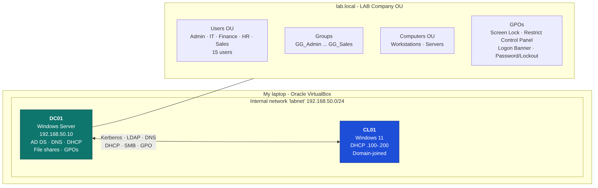
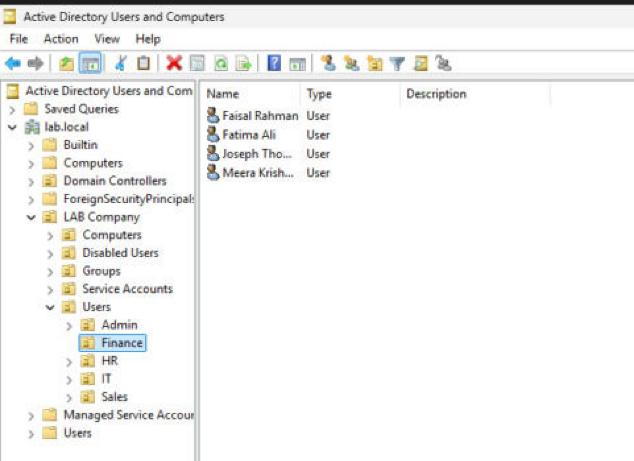
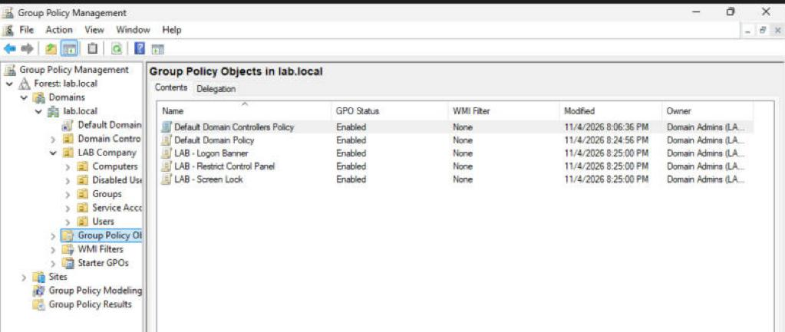

# Active Directory Home Lab

A small company's Windows network, built and automated with PowerShell: a domain controller running **AD DS, DNS and DHCP**, a domain-joined Windows 11 client, **15 users in 5 departments**, **Group Policy** for security and lockdown, and **department file shares** with NTFS permissions and mapped drives.

> **Status: lab build in progress.** Design, automation scripts and build guide are complete. Screenshots and test results are added as I complete each step.

## Lab design

| Area | Details |
|---|---|
| **Domain** | `lab.local` forest on Windows Server (evaluation), DC01 at 192.168.50.10 with integrated DNS |
| **DHCP** | Authorised in AD, scope 192.168.50.100–200, DNS and domain options so clients find the domain automatically |
| **OU design** | `LAB Company` → Users (Admin, IT, Finance, HR, Sales), Computers (Workstations, Servers), Groups, Service Accounts, Disabled Users. New PCs are redirected to Workstations. |
| **Identity** | 15 users created in bulk from CSV, a global security group per department, password change forced at first logon |
| **Security policy** | Min 10-character complex passwords, 24-password history, 90-day expiry, lockout after 5 failed attempts |
| **Group Policy** | Screen lock after 10 min (all staff) · Control Panel blocked for non-IT staff · logon banner on workstations |
| **File services** | Hidden department shares (`\\DC01\Finance$` …) with inheritance removed and Modify only for that department's group, a read-only Public share, and drives P: and S: mapped by logon script |
| **Client** | Windows 11 VM (CL01) joined to the domain, policies verified with `gpresult` |

## Skills shown

Active Directory Domain Services · DNS · DHCP · Group Policy · OU design · security groups and AGDLP-style access · NTFS and share permissions · PowerShell automation · domain join · troubleshooting (DNS, GPO, lockouts) · virtualisation (VirtualBox)

## How it's automated

Each build step is an idempotent PowerShell script, so it's safe to re-run:

| Script | Purpose |
|---|---|
| `01-Configure-DCNetwork.ps1` | Static IP, DNS to self, rename to DC01 |
| `02-Install-ADDS.ps1` | AD DS + DNS roles, new forest lab.local |
| `03-Configure-DHCP.ps1` | DHCP role, AD authorisation, scope and options |
| `04-Create-OUStructure.ps1` | OU tree, department groups, `redircmp` |
| `05-New-BulkUsers.ps1` | Users from `users.csv`, group membership, CSV log |
| `06-Configure-GPOs.ps1` | Password/lockout policy, 3 GPOs created and linked |
| `07-Create-FileShares.ps1` | Shares, NTFS permissions, drive-mapping logon script |
| `08-Join-Domain.ps1` | DNS/SRV checks and domain join from the client |

The full build and test steps are in **[GUIDE.md](GUIDE.md)**.

## Test plan and helpdesk scenarios

<!-- When done, rename this heading to "Tests and helpdesk scenarios I ran" and keep only the ones you actually ran. -->

- Logged in as Finance and IT users and confirmed the different policies and drives
- Confirmed a Finance user is **denied** access to the HR share
- Locked an account with 5 bad passwords, found it with `Search-ADAccount -LockedOut` and unlocked it
- Reset a password and forced a change at next logon
- Moved a user between departments (OU + group change) and confirmed their drive changed
- Broke client DNS on purpose and fixed it, which is the most common reason a PC can't find the domain

<!-- UNHIDE once your screenshots are in a "screenshots" folder:
## Screenshots

( Add your own screenshots to a "screenshots" folder with these names. )
| | |
|---|---|
| OU structure and users |  |
| Group Policy objects |  |
| DHCP lease for the client |  |
| Bulk user creation |  |
| gpresult on the client |  |
| Mapped drives |  |
| Share access denied |  |
| Account unlock |  |

-->

<!-- UNHIDE and fill in once the lab is done:
## What I learned

( Write 3–5 lines in your own words once you've finished. For example: the problem that took longest to fix, why DNS matters so much for AD, what you'd do differently in production (separate file server, two DCs, backups). )

-->

## Related projects

- [Sysadmin PowerShell Toolkit](https://github.com/Suvinofficial/sysadmin-powershell-toolkit)
- [Cisco office network (Packet Tracer)](https://github.com/Suvinofficial/packet-tracer-office-network)
- [AWS VPC + EC2 web server](https://github.com/Suvinofficial/aws-vpc-ec2-webserver)

**Suvin V S**, Senior System Administrator · [Portfolio](https://suvinofficial.github.io) · [LinkedIn](https://www.linkedin.com/in/suvin-v-s-780102297)
